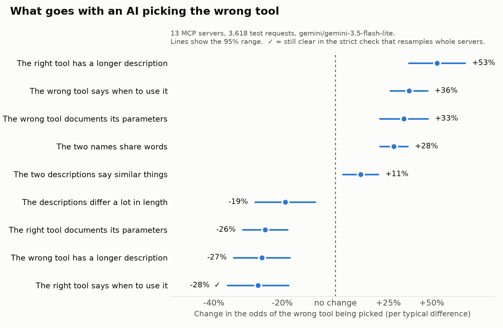
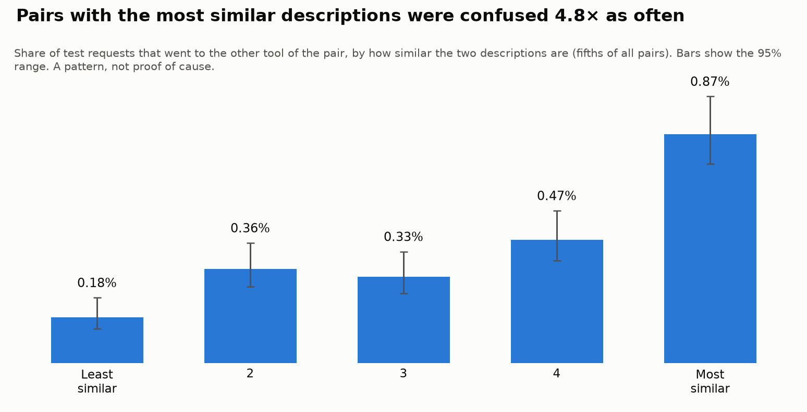

# Which MCP tools do models confuse, and why?

**Status:** Q1 results are in (2026-10-29). Q2 (cross-model) and Q3 (generated vs hand-written)
are still to come. Every number below comes from a file in `results/`; no finding is stated here
before the data shows it.

## Question

AI assistants choose a tool by reading short descriptions. When two descriptions sound alike,
the model can quietly pick the wrong tool. This study measures that on real MCP servers and asks
three questions:

1. **What makes two tools easy to confuse?** Candidate causes are similar descriptions,
   overlapping names, description length, undocumented parameters, and missing "use this
   when…" guidance.
2. **Does a cheap model's confusion predict a stronger model's?**
3. **Do auto-generated test requests give the same answers as hand-written ones?**

## Pre-registration

The analysis was fixed in [analysis-plan.md](analysis-plan.md) and committed on 2026-10-16,
before any benchmark result was analysed. It sets out the research questions, metrics,
exclusion rules, statistical models, multiple-comparison families and what counts as a null
result. Any change is listed, with a date, in that file's *Deviations* section.

## Setup

**Servers.**
- **Source.** The servers come from the official MCP registry. They were ranked by GitHub stars
  and capped per owner, and only servers that start without an API key were kept. The four MCP
  reference servers were added.
- **Snapshots.** Each server's tool list was captured once on a GitHub runner, sending only
  `initialize` and `tools/list`, and committed to `benchmark/snapshots/`. No tool was ever
  called.
- **Coverage.** Servers that could not be captured are listed in
  `benchmark/snapshots/index.json` with the reason.
- **Size limit.** A server with more than 120 tools is not measured. It is reported by size only.

**Measurement.** The tool is [mispick](../README.md).
- **Requests.** For each tool, mispick generates realistic user requests in three kinds:
  straightforward, paraphrased, and *hard negatives* written to sound like the tool's nearest
  neighbour. Each server also gets a few "no tool fits" requests. The generator is told to spell
  out concrete details rather than refer to missing context.
- **Selection.** For each request, the model sees the server's full tool list, as a client
  would send it, and picks one tool. Each request is asked K times.
- **Settings.** Model `gemini/gemini-3.5-flash-lite`, N=8 requests per tool, K=3, temperature 0.
  These come from `.github/workflows/benchmark.yml`. Gemini does not accept a seed, and the
  reports say so.
- **Schedule.** The free API tier allows a limited number of calls per day, so the run is
  spread over several days. It resumes from saved progress, and no call is repeated.
- **Errors.** A trial that errored, from a rate limit or a server error, is recorded as an error.
  It is never recorded as "the model chose nothing".

**Data freeze.** When the run completes, its output is committed to `analysis/data/benchmark-v1/`
with a checksum of every file (`analysis/fetch_results.py`). All analysis reads only that copy.

## Methods

**Primary metric.** The *pairwise confusion rate* of an ordered pair (A, B) is the share of
valid trials meant for tool A in which the model chose tool B.

**Q1: what predicts confusion.**
- **Model.** A mixed-effects logistic regression on trial-level outcomes, with random intercepts
  for server and for the intended tool within its server. It is fit with variational Bayes
  (`statsmodels`).
- **Predictors** (definitions in the plan, section 5):
  - embedding similarity of the two descriptions (`all-MiniLM-L6-v2` at a pinned revision)
  - name-token overlap, after dropping prefixes that most of a server's tools share
  - description lengths and their difference
  - the share of documented parameters
  - whether each description says when to use the tool
  - the server's tool count, as a covariate
- **Trials used.** Hard-negative requests are left out of the main model, because they are
  written to sound like the tool most similar by wording, and that would inflate the
  similarity predictors.
- **Sensitivity checks.**
  - a cluster bootstrap over servers
  - the model with hard negatives included
  - the model without the largest server
- **Multiple testing.** Benjamini-Hochberg across the predictor tests.

**Q2: cross-model transfer.**
- **Subset.** A stratified subset of servers: score thirds, a fixed seed, and a tool cap for
  cost.
- **Re-run.** The subset is re-run on one or two stronger models with the same snapshots and
  the exact same frozen requests.
- **Comparison.** A Spearman correlation of pairwise confusion rates with a bootstrap CI over
  servers, agreement on each server's top-3 confused pairs, and per-server McNemar tests with
  Benjamini-Hochberg.

**Q3: generated vs hand-written.**
- **Requests.** Four servers with distinct domains were chosen in advance. About 20 requests
  per server were written by hand, without seeing that server's generated requests or results,
  and measured with the same model and settings.
- **Comparison.** The accuracy difference with a bootstrap CI, judged against a ±10-point
  equivalence margin, and the overlap of confused pairs.

**Null results** are defined in advance in the plan, section 9, and are reported in the same way
as positive ones.

## Results

*All numbers in this section come from [`results/analysis.json`](../results/analysis.json),
computed from the frozen run in `analysis/data/benchmark-v1/`.*

### In short

- **Similar names and similar descriptions go with more mix-ups.** Both pass the pre-registered
  test, so by the plan's rule the result for Q1 is **"effect"**.
- **But the evidence is fragile.** With only 13 servers, a few large servers carry the pooled
  result. When whole servers are resampled, neither effect is clearly different from zero, and
  without the largest server the description-similarity effect reverses.
- **The clearest signal:** when a tool's description says **when to use it**, requests meant for
  it are less often taken by another tool. This is the only effect that also survives the strict
  whole-server check.
- **Mix-ups are rare but not random:** the most similar fifth of tool pairs were confused about
  5 times as often as the least similar fifth.





### What was measured

| | |
|---|---|
| Model | `gemini/gemini-3.5-flash-lite`, N=8, K=3, temperature 0 |
| Dates | 2026-10-17 to 2026-10-29 (one consistent model and setting throughout) |
| Servers analysed | 13 |
| Tools | 201 |
| Ordered tool pairs | 5,814 |
| Test requests (trials) in the main model | 3,618 (straightforward and paraphrased only) |
| Trial × other-tool rows | 104,652, of which 465 were a confusion |

**Excluded, by the pre-registered rules:**
- **Vaaya: every one of its trials errored.** Its tool list has a broken JSON Schema: a reference
  to a definition that doesn't exist (`booking → baggage`). Gemini rejects the whole tool list
  because of it, so the server cannot be used with Gemini at all. This is a finding about the
  server, not a model decision, and it will be reported upstream.
- **Sequential Thinking:** it has only one tool, so it has no pairs.
- **Not measured:** 15 registry candidates, all recorded in the frozen `index.json`:

  | Reason | Servers |
  |---|---|
  | Failed to start | 7 |
  | Needs credentials | 5 |
  | Needs arguments | 1 |
  | Package unavailable | 1 |
  | Over the 120-tool limit | 1 |

- **Tools:** none fell below the 12-valid-trial minimum.
- **Errored trials** on the analysed servers: none.

<details>
<summary><b>Full model output: odds ratios, intervals and all three sensitivity checks</b></summary>

The main model is a mixed-effects logistic regression with random intercepts for server and
for the intended tool, fit with variational Bayes. Odds ratios are per 1 SD of each predictor.
q is the Benjamini-Hochberg adjusted p-value (family F1).

| Predictor | Odds ratio | 95% interval | q |
|---|---|---|---|
| Name-token overlap (`name_jaccard`) | 1.28 | 1.21 to 1.36 | < 0.001 |
| Description similarity (`cos_sim`) | 1.11 | 1.03 to 1.20 | 0.005 |
| Intended tool states when to use it (`when_a`) | 0.72 | 0.63 to 0.82 | < 0.001 |
| Chosen tool states when to use it (`when_b`) | 1.36 | 1.26 to 1.47 | < 0.001 |
| Intended tool's description length (`log_len_a`) | 1.53 | 1.36 to 1.73 | < 0.001 |
| Chosen tool's description length (`log_len_b`) | 0.73 | 0.65 to 0.83 | < 0.001 |
| Length difference (`log_len_diff`) | 0.81 | 0.71 to 0.92 | 0.001 |
| Intended tool's documented parameters (`param_doc_a`) | 0.74 | 0.68 to 0.82 | < 0.001 |
| Chosen tool's documented parameters (`param_doc_b`) | 1.33 | 1.21 to 1.48 | < 0.001 |

The first two are the pre-registered confirmatory tests. The others are exploratory.

**Sensitivity checks.** These are reported as registered. None replaces the main result.

| Predictor | S1: whole-server bootstrap | S2: with hard negatives | S3: without the largest server |
|---|---|---|---|
| `name_jaccard` | 1.22 (0.88 to 1.56) | 1.24 (1.19 to 1.28) | 1.23 (1.12 to 1.34) |
| `cos_sim` | 1.17 (0.81 to 1.50) | 1.74 (1.66 to 1.82) | **0.84** (0.76 to 0.93) |
| `when_a` | **0.77 (0.46 to 0.98)** | 0.89 (0.82 to 0.96) | 0.76 (0.64 to 0.89) |
| `when_b` | 1.52 (0.74 to 2.36) | 1.17 (1.10 to 1.24) | 1.35 (1.27 to 1.44) |
| `log_len_a` | 1.30 (0.38 to 2.75) | 1.13 (1.05 to 1.22) | 1.41 (1.25 to 1.58) |
| `log_len_b` | 0.61 (0.40 to 2.27) | 0.66 (0.61 to 0.71) | **1.62** (1.44 to 1.83) |
| `log_len_diff` | 0.91 (0.13 to 1.32) | 0.85 (0.78 to 0.92) | 0.61 (0.55 to 0.69) |
| `param_doc_a` | 0.88 (0.68 to 3.10) | 0.79 (0.74 to 0.84) | 1.09 (0.99 to 1.20) |
| `param_doc_b` | 1.37 (0.65 to 2.85) | 1.33 (1.25 to 1.42) | 1.31 (1.17 to 1.46) |

- **S1** refits an ordinary logistic regression on 2,000 resamples of whole servers, with
  percentile intervals; 1 resample could not be fit. Only `when_a` keeps its interval clear of 1.
- **S2** adds the hard-negative requests. As the plan anticipated, they inflate the similarity
  effect, from 1.11 to 1.74, because they are written to sound like the most similar tool.
- **S3** drops `co-workix-mcp`, the 64-tool server that contributes most of the pairs.
  Description similarity then reverses, and so does the chosen tool's description length.

**How to read this.** The main model's intervals are much narrower than S1's. The main model
treats the K=3 repeats and the many pairs of one server as more independent than they are, and
variational Bayes is known to understate uncertainty. S1 is the more conservative read.
Four effects keep the same direction in the main model and all three checks: `name_jaccard`,
`when_a`, `when_b` and `param_doc_b`. Of those, only `when_a` also has a whole-server interval
clear of 1. Effects that flip between checks (`cos_sim`, `log_len_b`, `param_doc_a`) should not
be read as findings.

**Confusion by description similarity** (descriptive; pairs split into fifths by cosine
similarity):

| Fifth | Similarity range | Confusion rate | 95% interval |
|---|---|---|---|
| 1 (least similar) | −0.16 to 0.08 | 0.18% | 0.13% to 0.25% |
| 2 | 0.08 to 0.16 | 0.36% | 0.29% to 0.45% |
| 3 | 0.16 to 0.27 | 0.33% | 0.26% to 0.42% |
| 4 | 0.27 to 0.41 | 0.47% | 0.39% to 0.58% |
| 5 (most similar) | 0.41 to 0.95 | 0.87% | 0.75% to 1.01% |

</details>

**Not shown yet:** per-server results. They stay out of this write-up until the hand-written
comparison (Q3) is done, so that comparison can still be done blind. They are in
`results/analysis.json` and `results/server_accuracy.png`.

## Cross-model transfer

*Placeholder. Filled from `results/transfer.json`.*

## Generated vs hand-written requests

*Placeholder. Filled from `results/human_vs_generated.json`.*

## Limitations

These are known in advance and come from the design, not from the data.

- **One benchmark model.** The main results describe one model's confusions on one date. Q2
  tests how far they generalise.
- **Few servers.** After exclusions, few servers remain, so server-level variation is estimated
  poorly and many tool pairs have few trials.
- **Generated requests.** The benchmark's requests are written by the model being measured.
  Q3 checks how much that matters.
- **First call only.** mispick scores the first tool the model calls. A model that sensibly
  looks something up before acting counts as confused.
- **Repeats are not independent.** At temperature 0, the K repeats of a request mostly agree.
  The bootstrap over servers is the more conservative read.
- **Who gets measured.** Only servers that start without credentials are included, so
  popular services that need an API key are missing.

## Reproduce

```bash
uv sync --all-extras --group analysis
uv run python analysis/features.py --snapshots benchmark/snapshots --out results
uv run python analysis/analyze.py --features results/features.csv \
    --results analysis/data/benchmark-v1 --out results
uv run python analysis/transfer.py analyze
uv run python analysis/human_vs_generated.py analyze
```

[analysis/README.md](../analysis/README.md) has every step, including re-running the benchmark
itself.
